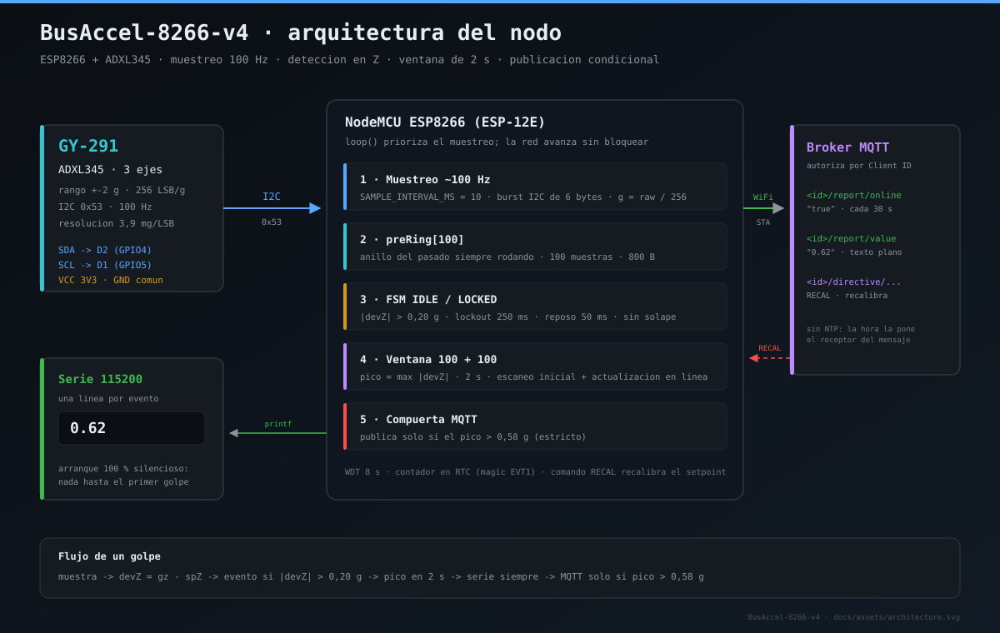
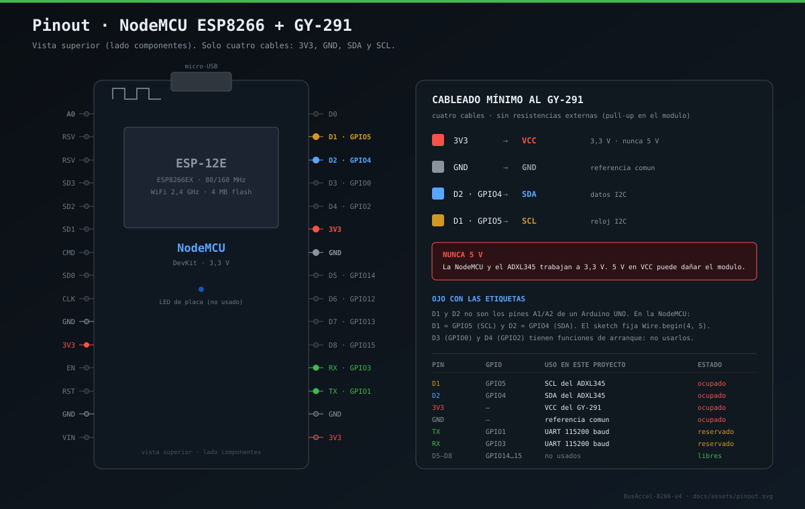
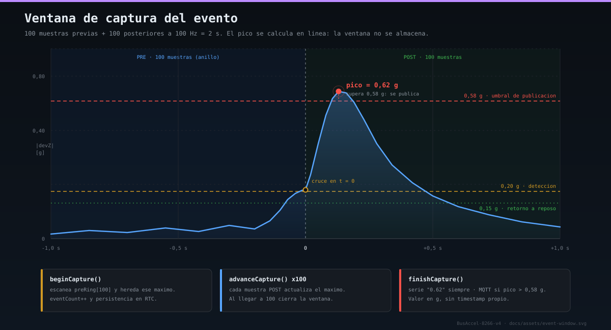

# BusAccel-8266-v4

**Nodo acelerómetro para bus urbano: detección de golpes verticales, pico del evento y telemetría MQTT condicional sobre ESP8266 + ADXL345.**

[](https://www.arduino.cc/)
[](https://www.analog.com/en/products/adxl345.html)
[](https://mqtt.org/)
[](LICENSE)
[](#limitaciones)

> **TL;DR** — El nodo muestrea el eje Z a ~100 Hz, aprende un setpoint del montaje, detecta desviaciones mayores a 0,20 g, mide el pico en una ventana de ±1 s y **solo publica por MQTT cuando el pico supera 0,58 g**. Todo evento detectado se imprime por serie en una línea con el valor en g. El arranque es silencioso y la red nunca bloquea el muestreo.

---

## Tabla de contenidos

- [1. Qué es este proyecto](#que-es)
- [2. El problema: mantenimiento vial sin datos](#problema)
- [3. Principio físico: cómo mide un acelerómetro MEMS](#fisica)
- [4. Arquitectura del nodo](#arquitectura)
- [5. Hardware y pinout](#hardware)
- [6. Diagrama de conexión](#conexion)
- [7. Cómo funciona el firmware](#funcionamiento)
- [8. MQTT: contrato, topics y formato](#mqtt)
- [9. Salida serie](#serie)
- [10. Instalación de herramientas](#instalacion)
- [11. Configuración de credenciales](#configuracion)
- [12. Compilación y carga](#compilar)
- [13. Calibración y montaje](#calibracion)
- [14. Pruebas y verificación](#pruebas)
- [15. Rendimiento y memoria](#rendimiento)
- [16. Seguridad](#seguridad)
- [17. Solución de problemas](#troubleshooting)
- [18. Limitaciones y trabajo futuro](#limitaciones)
- [19. Cómo se construyó](#construccion)
- [20. Estructura del repositorio](#estructura)
- [21. Referencias](#referencias)
- [22. Licencia](#licencia)

---

<a id="que-es"></a>
## 1. Qué es este proyecto

Firmware de un nodo de instrumentación de bajo costo que se instala en el chasis de un bus urbano para **registrar golpes verticales**. No es un datalogger continuo ni un sistema de navegación inercial: es un **detector de eventos** con una política de publicación muy concreta.

1. **Muestrea** el ADXL345 por I2C a ~100 Hz.
2. **Aprende** un setpoint (el nivel de aceleración que se considera reposo) promediando 20 lecturas, y lo recalcula mientras el vehículo está quieto.
3. **Detecta** un evento cuando la desviación del eje Z respecto del setpoint supera 0,20 g.
4. **Mide el pico** en una ventana de 2 s: 1 s de historia previa (siempre en un anillo) y 1 s posterior al cruce.
5. **Reporta**: imprime el pico por serie **siempre**, y lo publica por MQTT **solo si supera estrictamente 0,58 g**.

El resultado es un nodo de muy bajo tráfico: un latido cada 30 s y un mensaje corto por golpe relevante; los eventos menores quedan en serie pero no ensucian el broker.

| Dato | Valor |
|---|---|
| Placa objetivo | NodeMCU ESP8266 (módulo ESP-12E) |
| FQBN | `esp8266:esp8266:nodemcuv2` |
| Sensor | GY-291 / ADXL345, I2C `0x53` |
| Muestreo | ~100 Hz (`SAMPLE_INTERVAL_MS = 10`), rango ±2 g |
| Ventana | 100 muestras previas + 100 posteriores |
| Umbral de detección | 0,20 g |
| Umbral de publicación | 0,58 g (estricto) |

**Estado real, sin marketing:** prototipo validado en banco con golpes manuales, compilado con `arduino-cli` y revisado estáticamente. No se desplegó en una flota ni se contrastó contra un acelerómetro certificado o un perfil IRI. Las cifras de memoria de la [sección 15](#rendimiento) son las del compilador.

---

<a id="problema"></a>
## 2. El problema: mantenimiento vial sin datos

El mantenimiento de pavimento urbano suele ser **reactivo y subjetivo**: inspección visual, planilla y priorización por urgencia percibida. Ese proceso no es comparable entre tramos ("bache profundo" no es una unidad de medida), no deja trazabilidad temporal para verificar una repavimentación y no escala a cientos de kilómetros de calzada con una cuadrilla pequeña.

Los buses urbanos son un sensor distribuido natural: recorren la ciudad todos los días, por rutas fijas, con masa y suspensión conocidas y energía a bordo. Instrumentar un bus es mucho más barato que comprar un vehículo de auscultación con perfilómetro láser. La literatura de *crowdsensing* vial lleva más de una década explotando esta idea (ver [referencias](#referencias)).

El nodo aporta objetividad (un número en g, no una impresión), priorización (0,58 g separa golpes relevantes del ruido de rodadura), cobertura (cualquier bus es un punto de medida), repetición (mismo bus, ruta y montaje) y bajo costo.

**Qué no resuelve:** no mide IRI (requiere perfil longitudinal y modelo de cuarto de vehículo); no geolocaliza (sin GPS ni NTP, la plataforma aporta hora y posición por ruta); no distingue causa (bache, reductor, riel y frenazo pueden dar picos parecidos); y no reemplaza una inspección: es tamizaje, dice *dónde mirar primero*, no *qué reparar*.

---

<a id="fisica"></a>
## 3. Principio físico: cómo mide un acelerómetro MEMS

### 3.1 Una masa suspendida sobre silicio

El ADXL345 es un acelerómetro **MEMS capacitivo de tres ejes**: una masa de prueba de poli-silicio suspendida por vigas-resorte, rodeada de dedos conductores que forman condensadores diferenciales. Al acelerar, la masa se desplaza, cambia la capacidad y la electrónica la convierte en tensión, la digitaliza con un ADC de 13 bits y entrega las cuentas por I2C o SPI.

Es un sistema masa-resorte-amortiguador de segundo orden: a 100 Hz de *output data rate*, el filtro pasa-bajos deja pasar hasta ~50 Hz, así que el pico medido es el pico **dentro de esa banda** y un impacto muy agudo puede quedar atenuado.

### 3.2 Qué mide realmente: aceleración específica

Un acelerómetro en reposo **no mide cero**: mide 1 g en el eje que apunta hacia arriba, porque la masa es empujada por el soporte contra la gravedad. Lo que entrega es *aceleración específica* (fuerza por unidad de masa), no aceleración coordenada. Por eso el firmware promedia 20 lecturas y guarda ese vector como **setpoint** (gravedad proyectada sobre el montaje más el offset del sensor). La señal de interés es `devZ = gz - spZ`: un bus detenido en una pendiente de 5° no dispara eventos porque el setpoint absorbe el ángulo; lo que dispara es un cambio **dinámico**.

### 3.3 Por qué solo el eje Z

El nodo se monta con el eje Z perpendicular al piso. En esa orientación, **Z** captura la aceleración vertical (suspensión, baches, juntas, reductores) y **X/Y** capturan aceleraciones longitudinales y laterales (frenadas, curvas, arranques).

Para mantenimiento vial, el golpe vertical es la señal más limpia: frenar fuerte produce una desviación grande en X, pero no dice nada del pavimento. Por eso el firmware lee los tres ejes, pero **solo Z decide**.

### 3.4 Escala, resolución y conversión

| Concepto | Valor |
|---|---|
| Fondo de escala | ±2 g |
| Sensibilidad | 256 LSB/g |
| Resolución nominal | 1/256 g = 3,9 mg |
| Ruido típico | ~0,75 LSB rms (del orden de 3 mg) |
| Conversión usada | `g = raw / 256.0f` |
| Umbral de detección | 0,20 g ≈ 1,96 m/s² |
| Umbral de publicación | 0,58 g ≈ 5,69 m/s² |

La resolución no es el límite: el límite práctico es el ruido mecánico del vehículo y la banda del sensor.

### 3.5 Por qué no se integra la señal

El proyecto **no** integra la aceleración: esa operación amplifica la deriva del offset y el ruido y en pocos segundos da resultados sin sentido. El nodo mide amplitud de pico, nada más.

---

<a id="arquitectura"></a>
## 4. Arquitectura del nodo



La idea central es que **el muestreo nunca espera a la red**. Las reconexiones de WiFi y MQTT son máquinas de estado no bloqueantes, y el `loop()` les dedica tiempo solo después de atender el sensor.

Cadena: `readRawAxes()` → `pushSample()` (anillo de 100) → `processSample()` (setpoint y FSM) → `advanceCapture()` (pico en línea) → `finishCapture()` (serie siempre, MQTT condicional).

| Bloque | Responsabilidad |
|---|---|
| Adquisición | `readRawAxes()`, `readAccel()` — burst I2C de 6 bytes y conversión a g |
| Setpoint | Promedio por bloques de 20 muestras, solo en reposo |
| Detección | `processSample()` — FSM `ST_IDLE` / `ST_LOCKED` |
| Ventana | `pushSample()`, `beginCapture()`, `advanceCapture()`, `finishCapture()` |
| Serie | Una línea `%.2f` por evento; CSV a 20 Hz en modo alternativo |
| Red | `serviceWifi()`, `serviceMqtt()`, `client.loop()`, `servicePing()` |
| Persistencia | `loadEventCounter()` / `saveEventCounter()` en RTC user memory |
| Comandos | `mqttCallback()` — payload `RECAL` |
| Vigilancia | Watchdog de 8 s, watchdog de ping, stale publish |

**Por qué la red va después:** bloquear el `loop()` esperando `WiFi.begin()` o `client.connect()` dejaría sin muestras ese intervalo. Un bus a 40 km/h recorre 11 m/s: dos segundos de bloqueo son 22 metros sin medir, justo cuando la red está caída. Por eso las esperas se resuelven con sondeo: WiFi cada 250 ms (30 s antes de reiniciar), MQTT un intento por segundo (ventana de 120 s) y ping ICMP en segundo plano. El único `delay()` está en `runChipDiagnostic()` (50 ms), durante el arranque.

---

<a id="hardware"></a>
## 5. Hardware y pinout

### 5.1 Materiales

Se necesita una NodeMCU ESP8266 (ESP-12E, 4 MB), un GY-291 con ADXL345, cuatro cables dupont cortos (< 20 cm), alimentación de 5 V por micro-USB o VIN y una carcasa **plástica** (una metálica apantalla el WiFi).

### 5.2 Tabla de pines

| Pin Arduino / NodeMCU | GPIO | Modo | Componente conectado | Notas |
|---|---|---|---|---|
| D1 | GPIO5 | I2C SCL | GY-291 `SCL` | `Wire.begin(4, 5)`; pull-up en el módulo |
| D2 | GPIO4 | I2C SDA | GY-291 `SDA` | `Wire.begin(4, 5)`; no intercambiar con SCL |
| 3V3 | — | Alimentación | GY-291 `VCC` | **3,3 V. Nunca 5 V** |
| GND | — | Alimentación | GY-291 `GND` | Referencia común obligatoria |
| TX | GPIO1 | UART TX | Monitor serie / app | 115200 8N1; reservado |
| RX | GPIO3 | UART RX | Monitor serie / app | 115200 8N1; reservado |
| D3 | GPIO0 | — | Libre | Función de arranque: evitar |
| D4 | GPIO2 | — | Libre | LED de placa; evitar en instalación final |
| VIN | — | Alimentación | 5 V de entrada | Alternativa al micro-USB |

> **Atención a las etiquetas:** en una NodeMCU, `D1` y `D2` **no** son los pines analógicos de un Arduino UNO. Son GPIO5 y GPIO4. El sketch fija la correspondencia con `Wire.begin(4, 5)`.

### 5.3 Pinout gráfico



### 5.4 Notas eléctricas

- El ADXL345 acepta de 2,0 a 3,6 V y consume ~40 µA en medición: el regulador de la NodeMCU lo alimenta sin problema.
- El GY-291 suele incluir regulador y pull-ups de 10 kΩ. Con otro breakout, **verificar que los pull-ups vayan a 3,3 V**.
- No hay level shifter: todo el bus es de 3,3 V. Un pull-up a 5 V en SDA/SCL puede dañar el ESP8266.
- El bus es corto y va dentro de la carcasa. Con cables largos, bajar la velocidad o usar un buffer I2C.

---

<a id="conexion"></a>
## 6. Diagrama de conexión

```text
        NodeMCU ESP8266 (ESP-12E)                GY-291 / ADXL345
        ┌─────────────────────────┐              ┌──────────────────┐
        │   D1  (GPIO5)  SCL  ────┼──────────────┤ SCL              │
        │   D2  (GPIO4)  SDA  ────┼──────────────┤ SDA              │
        │   3V3               ────┼──────────────┤ VCC   (3,3 V)    │
        │   GND               ────┼──────────────┤ GND              │
        │   TX  (GPIO1)  ─────────┼──▶ USB ──▶ monitor serie 115200 │
        │   RX  (GPIO3)  ─────────┼──◀ USB ──◀ monitor serie        │
        └─────────────────────────┘              └──────────────────┘
```

**Pasos:** desconectar la alimentación; `3V3` → `VCC`; `GND` → `GND` (sin esta referencia común el bus no funciona); `D2` (GPIO4) → `SDA`; `D1` (GPIO5) → `SCL`; verificar que no haya 5 V ni cables cruzados; conectar el micro-USB.

**Alimentación en el vehículo:** el micro-USB no es robusto en un bus (se afloja con la vibración y una caída de tensión reinicia el nodo). Para una instalación real: fuente 5 V / 1 A desde 12/24 V con fusible, TVS y filtro; cables soldados a `VIN` y `GND` con alivio de tensión; carcasa plástica con el sensor rígidamente fijado. La NodeMCU **no es un producto automotriz**: no está calificada para ISO 7637-2 ni para el rango térmico de un vehículo.

---

<a id="funcionamiento"></a>
## 7. Cómo funciona el firmware

### 7.1 Setpoint automático

<a id="setpoint"></a>
El setpoint es el vector de aceleración que el nodo considera reposo. Cuando `accCount` llega a `SETPOINT_N` (20), cada eje se divide por 20 y se marca `setpointReady = true`.

A 100 Hz, la adquisición dura **200 ms**. Al arrancar, el bus debe estar quieto durante ese intervalo; si arranca en movimiento, el setpoint queda contaminado y la detección se sesga.

Mientras la FSM está en `ST_IDLE` sin evento activo, el promedio se **recalcula cada 20 muestras**: absorbe deriva térmica, cambios de ángulo por carga y diferencias de montaje. Se congela en `ST_LOCKED` para no "aprender" el golpe como nueva normalidad.

**Comando `RECAL`:** vuelve a `setpointReady = false` y reinicia los acumuladores. Permite recalibrar en caliente, sin desmontar ni reiniciar. Se envía por MQTT ([sección 8](#mqtt)).

### 7.2 Máquina de estados IDLE / LOCKED

<a id="fsm"></a>
La detección tiene dos estados y una sola variable de decisión: `devZ = gz - spZ`.

```text
  ST_IDLE ──|devZ| > 0,20 g──▶ ST_LOCKED
     ▲                             │
     └── (a) 250 ms · (b) reposo 50 ms · (c) !collecting
```

Al cruzar el umbral se clasifica el evento:

| Símbolo | Condición | Interpretación |
|---|---|---|
| `*` | `devZ ≥ +0,24 g` | Elevación severa |
| `+` | `devZ > +0,20 g` | Elevación leve |
| `!` | `devZ ≤ −0,24 g` | Caída severa |
| `-` | `devZ < −0,20 g` | Caída leve |

El símbolo se calcula siempre pero en MQTT **no se publica**: la salida es solo el número del pico. Se conserva para el modo CSV y para depurar.

**El desbloqueo exige tres condiciones simultáneas:**

1. **Lockout de 250 ms.** Evita que el rebote mecánico del golpe cuente como eventos múltiples.
2. **Reposo sostenido de 50 ms** con `|devZ| ≤ 0,15 g`. La histéresis impide que una señal que oscila alrededor del umbral genere una ráfaga.
3. **Ventana terminada** (`!collecting`). Sin esto, un segundo golpe a los 300 ms abriría una ventana mientras la anterior sigue contando, y el pico mezclaría dos eventos.

La tercera condición garantiza que **no haya ventanas solapadas**. Como la ventana dura 1 s después del cruce, la tasa máxima es de ~**un evento por segundo**.

### 7.3 Ventana de captura y pico

<a id="ventana"></a>


El firmware **no almacena la ventana completa**: un anillo `preRing[100]` guarda las últimas 100 muestras crudas (x, y, z, dt) en cada muestra, haya evento o no, y ocupa 100 × 8 = **800 bytes**. El pico se acumula en `eventPeakZ`.

**Apertura (`beginCapture`)** — guarda `eventDevZ` y el símbolo, inicializa `eventPeakZ = |devZ|`, **escanea las 100 entradas del anillo** para recuperar el pico previo (máximo `|z/256 − spZ|`), marca `collecting = true` y cuenta el evento.

**Avance (`advanceCapture`)** — en cada muestra posterior actualiza `eventPeakZ = max(eventPeakZ, |devZ|)` e incrementa `postCount`. La muestra que disparó el evento también pasa por acá, así que cuenta como la primera POST; la ventana se cierra 99 muestras después del cruce (~**990 ms**), y con el segundo de historia la cobertura efectiva es de ~1,99 s.

**Cierre (`finishCapture`)** — publica solo si `eventPeakZ > PUBLISH_MIN_PEAK_G` y siempre imprime `Serial.printf("%.2f\n", eventPeakZ)`. El pico es el **máximo de la desviación absoluta** en toda la ventana. No es promedio ni RMS: es el valor más alto que alcanzó el golpe, y por eso es sensible al pico instantáneo y no a la duración. Coste: O(100) al abrir y O(1) por muestra, sin copias ni asignaciones dinámicas.

### 7.4 Umbrales y salida serie

<a id="umbrales"></a>
| Constante | Valor | Función |
|---|---|---|
| `ARROW_THRESHOLD_G` | 0,20 g | **Dispara** un evento |
| `SEVERE_THRESHOLD_G` | 0,24 g | Clasifica el símbolo como severo |
| `RETURN_G` | 0,15 g | Histéresis para volver a reposo |
| `PUBLISH_MIN_PEAK_G` | 0,58 g | **Decide** si se publica por MQTT |

| Pico del evento | Evento | Línea serie | Publicación MQTT |
|---|---|---|---|
| ≤ 0,20 g | No | Nada | Nada |
| > 0,20 g y ≤ 0,58 g | Sí | **Sí**, una línea `%.2f` | **No** |
| > 0,58 g (estricto) | Sí | **Sí**, una línea `%.2f` | **Sí**, `report/value` |

Dos detalles: la impresión serie **no depende** del umbral MQTT (todo evento imprime su pico, aunque sea 0,21 g), y el umbral es **estricto**: un pico de exactamente 0,58 g no se publica; el redondeo hace que `"0.58"` solo aparezca si el valor interno superó 0,58.

---

<a id="mqtt"></a>
## 8. MQTT: contrato, topics y formato

### 8.1 Modelo de identidad

El broker autoriza por **Client ID**, que es además la raíz de todos los topics: `<id>/report/online`, `<id>/report/value` y `<id>/directive/<cmd>`. La suscripción es `<MQTT_CLIENT>/#`; el firmware **no valida el topic**, solo compara el payload con `RECAL`.

> **El Client ID debe ser único por placa**: el broker lo usa como identidad de sesión y dos nodos con el mismo ID se expulsan en un bucle de reconexión. En una flota, derivarlo del MAC.

### 8.2 Topics publicados

| Uso | Topic | Payload | Cuándo |
|---|---|---|---|
| Latido | `<id>/report/online` | `true` (texto plano) | Al conectar y cada 30 s |
| Pico relevante | `<id>/report/value` | `0.62` (texto plano) | Solo si el pico > 0,58 g |

El contrato es deliberadamente mínimo: latido y golpes, sin `report/setpoint` ni `report/status`.

### 8.3 Formato exacto del payload

El pico se formatea con `snprintf(msg, sizeof(msg), "%.2f", eventPeakZ)`: siempre dos decimales, punto como separador, sin unidad, sin JSON y sin prefijo. Ejemplo de secuencia en el broker:

```text
busaccel-nodo-01/report/online    true
busaccel-nodo-01/report/value     0.62
busaccel-nodo-01/report/value     1.07
```

Un evento de 0,44 g **no** viaja al broker: solo aparece en serie.

### 8.4 Calidad de servicio y garantías

| Propiedad | Valor real |
|---|---|
| Protocolo | MQTT 3.1.1 (PubSubClient) |
| QoS | 0 (fire and forget) |
| Retain | `false` |
| Last Will | **no configurado** |
| TLS | **no** (1883 en el ejemplo) |
| Buffer | 384 B (`MQTT_BUF_MAX`) |

Consecuencias honestas:

- **No hay garantía de entrega ni buffer offline.** Si el WiFi se cae en el instante del golpe, el mensaje se pierde: queda en el contador RTC y en la línea serie, pero no se reintenta.
- **No hay Last Will.** Al cortarse la alimentación el broker no publica un offline; la plataforma lo infiere por timeout de heartbeat.
- **El timestamp lo pone el receptor.** No hay NTP ni RTC de hora.

### 8.5 Comando RECAL

Se publica un mensaje cuyo **payload sea exactamente** `RECAL` bajo la raíz:

```bash
mosquitto_pub -h mqtt.example.com -p 1883 -u "$MQTT_USER" -P "$MQTT_PASS" \
  -t "busaccel-nodo-01/directive/RECAL" -m "RECAL"
```

El callback copia hasta 63 bytes y compara con `strcmp`; un espacio o un salto de línea final hacen que no coincida. Al recibirlo pone `setpointReady = false` y los acumuladores a cero: vuelve a promediar 20 muestras y queda operativo en ~200 ms, **sin reiniciar** ni perder la conexión.

### 8.6 Heartbeat

Al conectar se publica `report/online = "true"`, y luego cada 30 s mientras `client.connected()` sea verdadero (`HEARTBEAT_INTERVAL_MS`). La plataforma debería considerar al nodo en línea si recibió un latido en los últimos 90 s; no hay mensaje de despedida.

---

<a id="serie"></a>
## 9. Salida serie

**Modo normal (`MODE_SERIAL_CSV 0`)** — puerto a **115200 8N1**, **completamente silencioso** durante el arranque: sin banner, sin versión, sin diagnóstico, sin setpoint y sin eco de MQTT. La primera línea aparece recién con el primer evento:

```text
0.62
```

Se emite **una vez por evento**, contiene **solo el número** con dos decimales, termina en `\n` y se imprime para todos los eventos, incluso los que no se publican. En reposo el puerto no dice nada: si el monitor está vacío durante minutos, es lo esperado.

**Modo CSV (`MODE_SERIAL_CSV 1`)** — flujo continuo a **20 Hz** sin WiFi, para la herramienta de escritorio de v1/v2:

```text
12345,0.01,-0.02,0.98,0.00,0.00,1.00,.
12445,0.15,-0.05,1.20,0.00,0.00,1.00,+
```

Formato `millis,gx,gy,gz,spX,spY,spZ,sym`: tiempo desde el arranque en ms, aceleración instantánea en g, setpoint vigente en g y símbolo (`.` reposo, `+`/`-` leve, `*`/`!` severo). En este modo no se abre WiFi, no se publica MQTT y no se usa el contador RTC. El símbolo sale en el tick de 20 Hz posterior al cruce, hasta 50 ms después del evento.

---

<a id="instalacion"></a>
## 10. Instalación de herramientas

```bash
# 1. arduino-cli
curl -fsSL https://raw.githubusercontent.com/arduino/arduino-cli/master/install.sh | sh
arduino-cli version

# 2. core del ESP8266
arduino-cli config init
arduino-cli config add board_manager.additional_urls \
  https://arduino.esp8266.com/stable/package_esp8266com_index.json
arduino-cli core update-index
arduino-cli core install esp8266:esp8266

# 3. librerías
arduino-cli lib install "Adafruit Unified Sensor"
arduino-cli lib install "Adafruit ADXL345"
```

Validado con `esp8266:esp8266@3.1.2`; versiones nuevas deberían funcionar, pero pueden cambiar el consumo de IRAM.

Además de `Wire` y `ESP8266WiFi` (incluidas en el core), se usan `Adafruit Unified Sensor`, `Adafruit ADXL345` y `PubSubClient`. Verificar con `arduino-cli lib list` y `arduino-cli core list`. En Windows, descargar el binario de los releases oficiales y agregarlo al `PATH`.

**Drivers USB:** CH340/CH341 (`ch341ser`), CP2102 (`cp210x`) y FTDI (`ftdi_sio`); en Linux moderno vienen en el kernel. El usuario debe estar en el grupo `dialout`:

```bash
sudo usermod -aG dialout "$USER"
# cerrar sesión y volver a entrar
```

---

<a id="configuracion"></a>
## 11. Configuración de credenciales

El repositorio **no incluye** `secrets.h`. Se provee una plantilla:

```bash
cp secrets.example.h secrets.h
```

```cpp
#ifndef SECRETS_H
#define SECRETS_H

#define WIFI_SSID     "TU_RED_WIFI"
#define WIFI_PASSWORD "TU_CLAVE_WIFI"

#define MQTT_BROKER   "mqtt.example.com"
#define MQTT_PORT     1883
#define MQTT_USERNAME "TU_USUARIO"
#define MQTT_PASSWORD "TU_CLAVE_MQTT"
#define MQTT_CLIENT   "busaccel-nodo-01"

#endif
```

Todas las macros son obligatorias salvo `MQTT_USERNAME` y `MQTT_PASSWORD`, que pueden quedar vacías si el broker no las exige. `WIFI_SSID` debe ser una red de 2,4 GHz (el ESP8266 no soporta 5 GHz), el puerto 1883 va sin TLS y `MQTT_CLIENT` debe ser **único por placa**, porque también es la raíz de los topics.

> `secrets.h` está en `.gitignore`. Nunca debe commitearse. Si se filtró una credencial, rotarla en el broker y en el WiFi.

**Modos de compilación:**

```cpp
#define MODE_SERIAL_CSV  0
#define MQTT_DRY_RUN     0
```

| Directiva | Valor | Efecto |
|---|---|---|
| `MODE_SERIAL_CSV` | `0` | Modo normal: detección + MQTT |
| `MODE_SERIAL_CSV` | `1` | CSV a 20 Hz, **sin WiFi** |
| `MQTT_DRY_RUN` | `0` | MQTT real |
| `MQTT_DRY_RUN` | `1` | No abre WiFi ni MQTT; los envíos se descartan |

`MQTT_DRY_RUN 1` permite probar la detección sin credenciales ni red: imprime eventos y simula publicaciones en memoria.

---

<a id="compilar"></a>
## 12. Compilación y carga

```bash
cd BusAccel-8266-v4
arduino-cli compile --fqbn esp8266:esp8266:nodemcuv2 .
```

Salida esperada: `Sketch uses 267592 bytes (25%)` y `Global variables use 30128 bytes (37%)`, con 50064 bytes libres para variables locales.

```bash
# detectar el puerto
arduino-cli board list

# cargar (ajustar el puerto real)
arduino-cli upload -p /dev/ttyUSB0 --fqbn esp8266:esp8266:nodemcuv2 .

# monitor serie
arduino-cli monitor -p /dev/ttyUSB0 --config baudrate=115200
```

El puerto **nunca se hardcodea**: puede ser `/dev/ttyUSB0` (CH340/CP2102) o `/dev/ttyACM0` (CDC nativo). Si la carga falla con "failed to connect": probar otro cable USB (muchos son solo de carga), mantener `FLASH` al inicio, bajar la velocidad con `--upload-speed 115200` o revisar permisos de `dialout`.

En el arranque **no se verá nada**; golpear suavemente el sensor y debería aparecer `0.62`. Para el modo CSV, editar `#define MODE_SERIAL_CSV 1` y repetir compilación y carga.

---

<a id="calibracion"></a>
## 13. Calibración y montaje

**No hay calibración manual de offset.** El firmware no escribe `OFSX/OFSY/OFSZ`: el offset estático (inclinación, tolerancia del sensor, montaje) lo absorbe el **setpoint automático**. Eso simplifica el despliegue: no hay procedimiento con el vehículo nivelado ni instrumentos de referencia.

**Puesta en marcha:**

1. Fijar el nodo al chasis con el **eje Z perpendicular al piso**. Si no hay serigrafía, verificar con el modo CSV: en reposo, `gz ≈ 1.00` y `gx ≈ gy ≈ 0`.
2. Alimentar con el vehículo **detenido**.
3. Esperar al menos 1 s (200 ms de setpoint + margen para llenar el anillo).
4. Verificar el latido en `<id>/report/online`.
5. Dar un golpe controlado cerca del sensor (maza de goma o palmada firme en el chasis) y confirmar la línea serie.
6. Si el pico supera 0,58 g, confirmar `<id>/report/value`.

**Cuándo recalibrar:** cuando cambie el ángulo de montaje, se desmonte y reinstale el nodo, se agregue o quite carga permanente, o se observe una línea base desplazada en el CSV. No hace falta por temperatura: el recálculo cada 20 muestras absorbe la deriva lenta.

**Verificación de orientación con CSV:** en reposo debe verse `gz ≈ 1.00` y `gx ≈ gy ≈ 0`. Si `gz` está cerca de 0 y `gx` o `gy` cerca de ±1, el sensor está de costado y la detección en Z no funcionará.

**Ajuste de umbrales** (están en el sketch, no en `secrets.h`):

```cpp
#define ARROW_THRESHOLD_G    0.20f
#define SEVERE_FACTOR        1.2f
#define RETURN_G             0.15f
#define PUBLISH_MIN_PEAK_G   0.58f
```

- `RETURN_G` debe ser **menor** que `ARROW_THRESHOLD_G`; si no, se pierde la histéresis.
- `SEVERE_THRESHOLD_G` se deriva de `ARROW_THRESHOLD_G` con `SEVERE_FACTOR`; no es independiente.
- Bajar `PUBLISH_MIN_PEAK_G` aumenta el tráfico; subirlo puede ocultar defectos reales. Cambiar umbrales invalida la comparación con series históricas: versionar el firmware junto con los datos.

---

<a id="pruebas"></a>
## 14. Pruebas y verificación

| # | Prueba | Procedimiento | Resultado esperado |
|---|---|---|---|
| 1 | Arranque silencioso | Alimentar y abrir el monitor 10 s | Ninguna línea |
| 2 | Detección | Golpe suave en la mesa | Una línea `0.xx` |
| 3 | Umbral | Golpes cada vez más suaves | Deja de imprimir bajo ~0,20 g |
| 4 | Publicación condicional | Golpe de 0,3–0,5 g | Serie sí, MQTT no |
| 5 | Publicación | Golpe > 0,58 g | Serie + `report/value` |
| 6 | Heartbeat | Observar 70 s | `report/online` cada 30 s |
| 7 | RECAL | Publicar `RECAL` y golpear | Detecta tras ~200 ms |
| 8 | Sin solape | Dos golpes a 300 ms | Un solo evento |
| 9 | Sensor ausente | Desconectar SDA en marcha | Sin crash; reintenta cada 1 s |
| 10 | Corte de red | Apagar el AP | Muestreo y serie siguen |

**Golpe repetible sin equipamiento:** dejar caer una masa conocida (p. ej. una llave de 200 g) desde 5 cm sobre la mesa, junto al sensor, y repetir 10 veces. La dispersión es alta (±20 %), pero alcanza para verificar orden de magnitud y umbral; una verificación metrológica real requiere referencia calibrada y excitador, algo que este proyecto no hizo.

**Compuerta MQTT:**

```bash
mosquitto_sub -h mqtt.example.com -p 1883 \
  -u "$MQTT_USER" -P "$MQTT_PASS" \
  -t "busaccel-nodo-01/#" -v
```

Golpe suave: solo línea serie. Golpe fuerte: línea serie y `busaccel-nodo-01/report/value 0.62`.

**Reconexión:** desconectar el AP, esperar 30 s (el nodo reintenta y, si no logra conectar, se reinicia con MAC aleatoria), restaurar el AP y verificar que vuelve a publicar `report/online`.

**Estanqueidad del parser:** `RECAL` recalibra; `RECAL\n`, `recal` y `RECAL ` (espacio final) no. Si el comando no funciona, revisar los bytes exactos con un cliente que muestre el payload crudo.

---

<a id="rendimiento"></a>
## 15. Rendimiento y memoria

Cifras del compilador para el modo normal (`MODE_SERIAL_CSV 0`):

| Región | Usado | Total | % |
|---|---|---|---|
| Flash (partición de sketch) | 267.592 B | 1.048.576 B | 25 % |
| RAM (globales) | 30.128 B | 80.192 B | 37 % |
| IRAM | 61.011 B | 65.536 B | **93 %** |

La IRAM es el recurso crítico. El SDK de WiFi consume la mayor parte y al sketch le quedan unos **4,5 KB**. Cualquier expansión grande (TLS, JSON, OTA, un segundo sensor con buffers) puede agotar ese margen y fallar en el enlace. La RAM dinámica, en cambio, tiene ~50 KB libres.

| Tarea | Coste aproximado | Frecuencia |
|---|---|---|
| Burst I2C de 6 bytes a 100 kHz | ~1 ms | 100 Hz |
| Conversión y FSM | < 0,1 ms | 100 Hz |
| `Serial.printf` de una línea | ~0,4 ms | por evento |
| `beginCapture` (escaneo de 100) | < 0,1 ms | por evento |
| `client.loop()` | variable, no bloqueante | cada iteración |
| Ping ICMP | en segundo plano | cada 30 s |

El muestreo ocupa ~**10 %** del CPU a 100 kHz de I2C; el resto queda para la pila de red. Sin esperas activas, el jitter depende sobre todo de las interrupciones del WiFi.

Como el desbloqueo exige que la ventana haya terminado, la tasa máxima sostenida es de **~1 evento/s**, muy lejos de los pocos eventos relevantes por kilómetro de un bus urbano. El tráfico es de 4 bytes cada 30 s (latido) más 4–5 bytes por evento publicado: el cuello de botella no es el ancho de banda, sino la confiabilidad del enlace.

El ESP8266 con WiFi consume 70–170 mA (picos de ~300 mA), el ADXL345 ~40 µA y el regulador suma pérdidas: el WiFi domina. Para operación a batería habría que usar deep sleep y despertar por interrupción del ADXL345, algo que esta versión **no** implementa.

---

<a id="seguridad"></a>
## 16. Seguridad

| Componente | Estado | Riesgo |
|---|---|---|
| WiFi | WPA2, credenciales en `secrets.h` | Medio: la clave está en el dispositivo |
| MQTT | Puerto 1883, sin TLS | **Alto**: usuario y contraseña viajan en claro |
| Comandos | `RECAL` sin autenticación adicional | Medio: depende de las ACL del broker |
| Firmware | Sin OTA ni secure boot | Bajo en exposición, alto en esfuerzo de actualización |
| Físico | Carcasa y USB accesibles | Alto si el bus es público |

**Recomendaciones:**

1. **No usar 1883 en una red abierta.** Migrar a 8883 con TLS; en ESP8266 consume RAM e IRAM, hay que medirlo.
2. **Credenciales únicas por placa.** Permite revocar una unidad sin afectar al resto.
3. **ACL estrictas.** Cada Client ID solo debe publicar en su `<id>/report/#` y suscribirse a `<id>/directive/#`. Sin esto, cualquier cliente lee o inyecta mensajes de otro.
4. **Proteger `RECAL`.** Inundarlo mantiene al nodo en adquisición de setpoint y lo deja ciego; limitar la escritura por ACL y tasa.
5. **Segmentar la red y proteger el equipo.** Nodos en una VLAN de IoT sin acceso a la corporativa, y carcasa cerrada con precinto: el USB permite reflashear.

**Gestión de secretos:** `secrets.h` está en `.gitignore` y no se versiona; `secrets.example.h` solo contiene placeholders. No hay claves privadas ni certificados en el repositorio. Si se rota la contraseña WiFi hay que recompilar y reflashear cada nodo: no hay aprovisionamiento remoto.

**Límites asumidos:** es un prototipo de instrumentación, no un dispositivo de seguridad. No tiene arranque seguro, no valida la integridad del firmware y no cifra datos en reposo (no almacena). La confianza se apoya en la segregación de red y en las credenciales del broker.

---

<a id="troubleshooting"></a>
## 17. Solución de problemas

| Síntoma | Causa probable | Qué hacer |
|---|---|---|
| No imprime nada al arrancar | Comportamiento esperado | El arranque es silencioso; golpear para verificar |
| No imprime nunca | Sensor no detectado / cableado | Revisar 3V3, GND, SDA en D2 y SCL en D1 |
| Valores absurdos | I2C inestable o mala alimentación | Cables cortos, 3,3 V estable, revisar soldaduras |
| `gz ≈ 0` y `gx ≈ 1` | Sensor de costado | Reorientar con Z vertical |
| No publica nada | Sin WiFi, broker caído o credenciales | Verificar heartbeat y logs del broker |
| Se reinicia cada ~30 s | WiFi no conecta | Revisar SSID, clave y banda 2,4 GHz |
| Se reinicia cada ~2 min | MQTT no conecta | Revisar host, puerto, usuario y Client ID |
| Se reinicia cada 15 min | Stale publish | Revisar conectividad; es el watchdog de inactividad |
| Dos nodos se desconectan entre sí | Mismo `MQTT_CLIENT` | ID único por placa |
| `RECAL` no hace nada | Payload con espacios o salto | Enviar exactamente `RECAL` |
| El broker no ve `report/online` | Topic mal armado o ACL | Verificar `<id>/report/online` y permisos |
| Se reinicia al golpear | Alimentación floja o USB suelto | Fuente estable, cables soldados |


**Diagnóstico del sensor:** compilar con `MODE_SERIAL_CSV 1`. Si el CSV muestra `gz ≈ 1` en reposo, sensor y bus están bien; si no aparece ninguna línea, el problema es de hardware o inicialización. Un sketch I2C scanner confirma si responde en `0x53`.

**Diagnóstico de red:** confirmar AP de 2,4 GHz, DNS del broker, `nc -vz mqtt.example.com 1883` y los logs de rechazo (usuario, ACL, Client ID duplicado). El nodo reinicia con MAC aleatoria si no conecta en 30 s (WiFi) o 120 s (MQTT).

---

<a id="limitaciones"></a>
## 18. Limitaciones y trabajo futuro

**De medición:** un solo eje (Z), que no distingue bache de frenazo lateral; banda de ~50 Hz que atenúa impactos muy agudos; resolución de 3,9 mg y ruido de ~3 mg (el umbral de 0,20 g está 50 veces por encima, pero el pico absoluto tiene incertidumbre); sin calibración trazable; y el montaje afecta la medición, así que dos buses no son comparables sin caracterizar la transferencia.

**De datos:** sin GPS ni timestamp propio; sin almacenamiento local (si se cae la red, el evento queda solo en serie y en el contador RTC); QoS 0 y sin reintentos; sin Last Will (la caída se detecta por timeout de heartbeat).

**De firmware:** sin OTA (actualizar requiere USB); sin TLS; IRAM al 93 % con poco margen; el contador de eventos se guarda en RTC pero **no se publica** en v4; y el arranque silencioso complica el diagnóstico en campo.

**De operación:** ~1 evento/s máximo; el nodo recalcula el setpoint en cualquier reposo, incluso en un semáforo; y un evento en el primer segundo tras el arranque puede reportar un pico falso de ~1 g porque el anillo todavía contiene ceros (ventana de 1 s, detallada en la bitácora).

| Prioridad | Mejora | Por qué |
|---|---|---|
| Alta | Buffer circular con reintento MQTT | No perder eventos durante cortes |
| Alta | GPS o NTP + timestamp en payload | Georreferenciar y ordenar |
| Alta | TLS en 8883 | Proteger credenciales y datos |
| Media | Detección multi-eje con clasificación | Distinguir bache, reductor y frenada |
| Media | Contador en flash con desgaste controlado | Sobrevivir cortes de energía |
| Media | OTA firmada | Actualizar flota sin desmontar |
| Baja | Deep sleep con interrupción del ADXL345 | Operación a batería |

---

<a id="construccion"></a>
## 19. Cómo se construyó

| Versión | Aporte principal |
|---|---|
| v1 | CSV a 20 Hz para la app de escritorio |
| v2 | Setpoint, símbolos y umbrales |
| v3 | MQTT, reconexión no bloqueante, ping watchdog y contador RTC |
| v4 | Publicación condicional (> 0,58 g), arranque silencioso y una línea por evento |

**Método:** especificación escrita antes del código; sketch único y auditable; compilación con `arduino-cli` en cada iteración; prueba de banco; revisión estática de pines, buffers y tiempos; y corrección hasta cerrar las incidencias.

**Hallazgos que cambiaron el diseño:**

- **Se eliminó `i2cBusRecover()`.** La secuencia de pulsos sobre SCL/SDA dejaba al ADXL345 sin responder (`WHO_AM_I` sin ACK) aunque el bus estuviera sano. Sin ella, responde siempre en `0x53` con `WHO_AM_I = 0xE5`. Nota en el código: **no reintroducir**.
- **Se corrigió el uso de la RTC.** `ESP.rtcUserMemoryRead/Write` esperan el tamaño en **bytes**, no en palabras; las llamadas originales escribían de más. Ahora todas usan `sizeof(...)`.
- **Se eliminó el buffer MQTT global.** `client.setBufferSize(MQTT_BUF_MAX)` reemplaza al `mqttBuf[384]` propio y ahorra RAM.
- **Se pasó de JSON a texto plano.** El plan imaginaba `report/peak` con `{"peak":0.62}`; el código usa `report/value` con `"0.62"`. Se documentó el contrato real.
- **Se hizo silencioso el arranque.** El diagnóstico por serie generaba ruido y filtraba configuración.

**Descartado:** publicar todos los eventos (tráfico y ruido); guardar la ventana de 200 muestras (1,6 KB de RAM y copias, el pico en línea alcanza); detección multi-eje (X/Y agregan falsos positivos); reconexión bloqueante (pierde muestras); flash (desgaste, la RTC alcanza); NTP (la hora la aporta el receptor); `delay()` en el lazo (rompe los 100 Hz).

El alcance real está acotado en la [sección 18](#limitaciones): banco, no flota; sin referencia calibrada; sin ensayo ambiental ni estadística de campo.

---

<a id="estructura"></a>
## 20. Estructura del repositorio

```text
BusAccel-8266-v4/
├── BusAccel-8266-v4.ino      # Firmware completo (915 líneas)
├── secrets.example.h         # Plantilla de credenciales
├── README.md                 # Este documento
├── LICENSE                   # MIT
├── .gitignore                # Excluye secrets.h y artefactos
└── docs/
    ├── datasheet.md          # Manual de operador
    ├── developer.md          # Guía técnica del firmware
    ├── BITACORA.md           # Decisiones, problemas y lecciones
    ├── REFERENCES.md         # Fuentes y lecturas
    └── assets/               # architecture.svg, event-window.svg, pinout.svg
```

`secrets.h` no está en el repositorio: se crea a partir de `secrets.example.h`.

---

<a id="referencias"></a>
## 21. Referencias

Las fuentes completas están en [`docs/REFERENCES.md`](docs/REFERENCES.md). Resumen:

- **ADXL345** — Analog Devices, *3-Axis, ±2 g/±4 g/±8 g/±16 g Digital Accelerometer*, datasheet.
- **ESP8266 Arduino core** — documentación de `Wire`, `ESP`, RTC user memory y watchdog.
- **PubSubClient** — Nick O'Leary, cliente MQTT para Arduino.
- **MQTT 3.1.1** — OASIS Standard.
- **ISO 8608** — perfiles de rugosidad de pavimento.
- **Eriksson et al. (2008)** — *The Pothole Patrol*, detección de baches con sensores móviles.

---

<a id="licencia"></a>
## 22. Licencia

MIT. Ver [`LICENSE`](LICENSE).

```text
Copyright (c) 2026 wanderc137
```

El software se entrega "tal cual", sin garantía. Para uso en vehículos, la responsabilidad de la instalación eléctrica, la protección contra transitorios y el cumplimiento normativo es de quien despliega el equipo.
